# autoware_ndt_scan_matcher_common

## Purpose

This package holds the interface between [autoware_ndt_scan_matcher](../autoware_ndt_scan_matcher/README.md) and its NDT backends. An NDT backend is an implementation of NDT scan matching that the node loads with [pluginlib](https://github.com/ros/pluginlib). This package has headers only.

A backend package depends on this package, not on the node and its ROS dependencies.



## Contents

- `autoware::ndt_scan_matcher::NdtBackend` in `autoware/ndt_scan_matcher_common/ndt_backend.hpp`: the interface of a backend. Its comments state the rules for a backend: instances, threads, the order of calls, exceptions, copies and the lifetime of the library.
- `autoware::ndt_scan_matcher::NdtParams` and `autoware::ndt_scan_matcher::NdtResult` in `autoware/ndt_scan_matcher_common/ndt_types.hpp`: the parameters and the result of an alignment. The comments of `NdtResult` state how the node uses each field and how a backend must compute the scores.

## How the node uses a backend

The node has two instances of the backend: the active instance, and the instance that the map update thread builds. It calls them in three places:

1. At startup, pluginlib makes the backend with the name in `ndt.backend`, and the node calls `initialize()`.
2. The map update thread changes the map of the second instance with `add_target()`, `remove_target()` and `commit_target()`. Then the node swaps the two instances under a short lock.
3. The scan callback calls `align()` on the active instance for each scan. The node compares the scores of the `NdtResult` with its thresholds and accepts or rejects the pose.



The comments in `ndt_backend.hpp` state the exact rules for each of these calls.

## Add a backend



A backend package does these steps:

1. Depend on `autoware_ndt_scan_matcher_common` and `pluginlib` in `package.xml`.
2. Implement `autoware::ndt_scan_matcher::NdtBackend`, and export the class with `PLUGINLIB_EXPORT_CLASS`.
3. Build the class into a library with `add_library()`, and install the library. Do not use `ament_auto_add_library()`: ament_auto exports the library and links it into the packages that depend on the backend package. pluginlib loads the library at runtime, so no other library may link it.
4. Register the class with `pluginlib_export_plugin_description_file(autoware_ndt_scan_matcher_common <file>.xml)`.

`CMakeLists.txt`:

```cmake
cmake_minimum_required(VERSION 3.14)
project(my_package)

find_package(ament_cmake_auto REQUIRED)
ament_auto_find_build_dependencies()

add_library(my_ndt_backend SHARED src/my_ndt_backend.cpp)
ament_target_dependencies(my_ndt_backend autoware_ndt_scan_matcher_common pluginlib)
install(TARGETS my_ndt_backend LIBRARY DESTINATION lib)
pluginlib_export_plugin_description_file(autoware_ndt_scan_matcher_common plugins.xml)

ament_auto_package()
```

`plugins.xml`:

```xml
<library path="my_ndt_backend">
  <class name="my" type="my_package::MyNdtBackend" base_class_type="autoware::ndt_scan_matcher::NdtBackend">
    <description>My NDT backend.</description>
  </class>
</library>
```

`path` is the name of the library. `type` is the class that `PLUGINLIB_EXPORT_CLASS` exports. `name` is the value of `ndt.backend` that selects the backend. Use a short, lowercase name that tells the implementation, for example `ndt_omp` or `ndt_cuda`. A name must be unique among all installed backends, so do not use only the name of a technology that other implementations can also use, for example `cuda`.

## Compile options

`NdtResult` holds fixed-size `Eigen` types, which pass between the node and the backend library. Their memory layout depends on the static alignment of `Eigen`, which depends on the SIMD options of the compiler: AVX changes it, and SSE does not. The node also frees vectors that the backend allocated with the allocator of `Eigen`. Some options change this allocator, for example AVX or the address sanitizer of GCC.

The types and the interface are in an inline namespace whose name holds the version of the interface, the `Eigen` alignment (`EIGEN_MAX_STATIC_ALIGN_BYTES`) and the `Eigen` allocator. A backend that was built against another version of the interface, or with an alignment or an allocator that differs from the node, has other C++ symbols. Then the node loads its library but finds no factory for the backend, and it stops with an error message that names this cause. Rebuild the backend against the same version of Autoware Core, and do not enable AVX or a sanitizer in only one of the two. The name does not hold the version of `Eigen`, so the node and the backend must also use the same `Eigen`.

When a declaration in `ndt_types.hpp` or `ndt_backend.hpp` changes, change the version `v1` in the name of the inline namespace.
